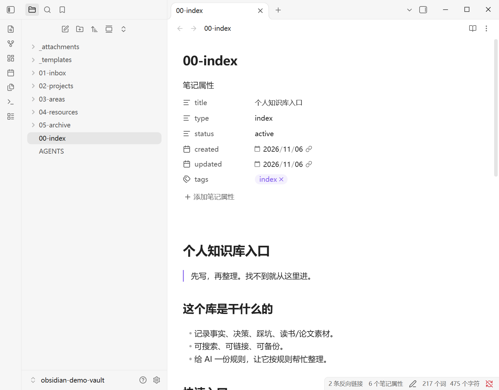
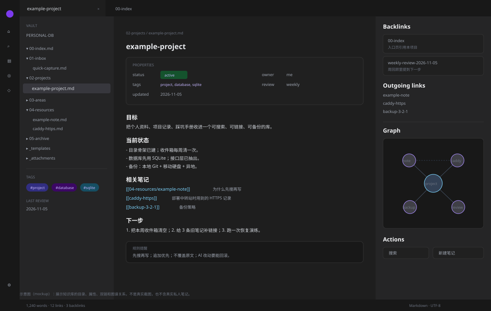

# Personal Knowledge Base · 个人数据库 (A Markdown Knowledge Base Skeleton)

> **Language / 语言**: [中文](README.md) | English
> **Name / 名称**: Personal Knowledge Base · 个人数据库

> A personal knowledge base that is **searchable, linkable, backup-friendly, and maintainable by AI**.
> Not tied to any one app: the core is Markdown files; Obsidian is just the least-effort viewer.
> Good for: reading notes, project records, decision logs, troubleshooting handbooks, paper material, a daily inbox.
>
> - New to AI? Read this `README`.
> - Want AI to build or tidy your vault? Hand `AI-INSTALL.en.md` to the AI.
> - The rules live in `vault-template/AGENTS.md`; this repo is a **generic skeleton**, not your private notes.

<p>
  
  
  
  
</p>

## Overview

This is a **personal knowledge base skeleton that is not tied to any app**: the core is Markdown files, and Obsidian is just the least-effort viewer. Folders, templates, wikilinks, weekly review, backup, and rules for AI maintenance are all provided as a minimum viable version.

**Who it's for**

- People whose notes are scattered across WeChat, cloud drives, and the desktop, who want them in one searchable vault.
- People who want to use Obsidian but don't want to design 20 folders on day one.
- People who want AI to help organize, but are afraid it will mess up the originals.

**Who it's not for**

- Team knowledge bases that need real-time multi-user collaboration and permission approvals.
- People who want "fully automatic organizing with zero review of their own"; this workflow still needs 10 minutes a week.
- People who must keep their data in some cloud SaaS and won't accept local files.

**What you get**

| Artifact | Location |
|---|---|
| Human-facing setup/workflow/backup/privacy | `README.en.md` (this document) |
| AI setup/merge/verification protocol | `AI-INSTALL.en.md` (Chinese: `AI-INSTALL.md`) |
| Vault skeleton you can copy directly | `vault-template/` |
| Note/project/meeting templates | `vault-template/_templates/` |
| Rules, workflow, backup, troubleshooting | `docs/` (Chinese) |
| Broken-link/orphan check script | `scripts/check-links.py` |
| Layout diagram | `docs/images/` |

> English scope: this README and `AI-INSTALL.en.md` are complete translations. The optional deep-dive files under `docs/` are currently in Chinese.

**Three steps for beginners**

1. Copy `vault-template/` to a location you can find, and open it with Obsidian.
2. Clear the sample notes first, keeping only `00-index.md` and `AGENTS.md`.
3. Follow section 6 for one week: inbox → projects/areas/resources → weekly review.

---

## Preview

**Real screenshot from this machine**: Obsidian 1.15.0 with the sample vault open — pinned folder tree on the left, `00-index` with its properties in the middle.



**Full layout diagram**: the same setup plus backlinks and the graph view.



> The real screenshot uses the sample vault and contains no actual private notes; the diagram only illustrates the backlinks panel and graph view on the right.

---

## Table of Contents

- [1. What It Is](#1-what-it-is)
- [2. Five Design Principles](#2-five-design-principles)
- [3. Folder Structure](#3-folder-structure)
- [4. Quick Start](#4-quick-start)
- [5. How to Write a Note](#5-how-to-write-a-note)
- [6. Daily Workflow](#6-daily-workflow)
- [7. Let AI Maintain It](#7-let-ai-maintain-it)
- [8. Search and Review](#8-search-and-review)
- [9. Backup](#9-backup)
- [10. Privacy](#10-privacy)
- [11. FAQ](#11-faq)
- [Appendix A: File Inventory](#appendix-a-file-inventory)
- [Appendix B: Minimal Example](#appendix-b-minimal-example)

---

## 1. What It Is

A personal knowledge base is not "install one piece of software"; it is:

```text
a pile of Markdown files
  + stable folders/naming
  + wikilinks
  + tags/properties
  + regular review
  + backup
  + optional AI retrieval/writing
```

The problems it solves:

| Problem | Approach |
|---|---|
| Can't find things | Fixed entry point + search + links |
| You write but never read | Inbox + weekly review |
| The same thing written three times | Search before writing, merge into one note |
| AI mangles your notes | Rules + read-before-write + append-first |
| You lose everything when you switch apps | Pure Markdown, migratable at any time |
| It's gone when the computer dies | Git + off-site backup |

> Don't design 20 folders on day one. Get it usable first, then let structure grow.

---

## 2. Five Design Principles

### 2.1 One Note, One Topic

Make the title state the "conclusion/question", not "miscellaneous".

```text
Good: How to get automatic HTTPS with Caddy
Bad: note1
```

### 2.2 Search Before Writing

Before creating a note, search titles/tags/keywords. If one exists, append to it instead of duplicating it.

### 2.3 Links Before Folders

Folders only separate broad categories; real relationships go through `[[wikilink]]`.

```markdown
See [[caddy-https]] and [[backup-3-2-1]].
```

### 2.4 Keep Facts and Inferences Separate

```markdown
[Fact] Caddy requests a certificate automatically on first start.
[Inference] If port 80 is unreachable, ACME will fail. (Confidence: high)
[Unverified] Behavior behind a Cloudflare proxy.
```

### 2.5 Review on a Schedule

A note collection without review = a dump.
Clear the inbox weekly, merge duplicates monthly, archive quarterly.

---

## 3. Folder Structure

```text
vault/
├─ 00-index.md              ★ Entry: start here
├─ 01-inbox/                Inbox: capture first, organize later
├─ 02-projects/             Things with a deadline/deliverable
├─ 03-areas/                Long-term responsibilities (health/finance/team)
├─ 04-resources/            Subject material (tech/reading/papers)
├─ 05-archive/              Done/obsolete, kept searchable
├─ _templates/              Templates
│  ├─ note.md
│  ├─ project.md
│  └─ meeting.md
├─ _attachments/            Images/PDFs (optional)
└─ AGENTS.md                Rules for AI
```

Rules:

- Use English kebab-case for folder names; content can be in Chinese.
- Move a finished project to `05-archive/`; don't delete it.
- The inbox is allowed to be messy, but it must be cleared every week.
- Put attachments in `_attachments/`; don't scatter them.

> This is a skeleton, not law. You can rename folders, but don't skip these three things: **entry, inbox, archive**.

---

## 4. Quick Start

### 4.1 Copy the Skeleton

```bash
cp -r vault-template ~/my-vault
cd ~/my-vault
```

Windows:

```powershell
Copy-Item .\vault-template "$env:USERPROFILE\my-vault" -Recurse
```

### 4.2 Open It with Obsidian

1. Install Obsidian.
2. Choose "Open folder as vault" and select `my-vault`.
3. Open `00-index.md`.
4. Settings → Files and links → use `[[Wikilinks]]`.

> You don't have to use Obsidian: VS Code + Markdown preview, Typora, and Logseq can all read it.

### 4.3 Write Your First Note

Create a new note in `01-inbox/`:

```markdown
---
title: A command I learned today
type: note
status: inbox
created: 2026-11-06
tags: [cli, linux]
---

# A command I learned today

`ss -lntp` shows which ports are listening on this machine.

[Fact] `-l` shows listening sockets only, `-n` skips service-name resolution, `-p` shows the process.
[Todo] Add this to [[linux-cheatsheet]].
```

### 4.4 Link It

In `00-index.md`, add:

```markdown
- [[A command I learned today]]
```

### 4.5 Weekly Tidy-Up

For each note in the inbox:

- merge it into an existing topic;
- move it to `02-projects/` / `03-areas/` / `04-resources/`;
- add tags/sources;
- add links;
- archive the outdated ones.

---

## 5. How to Write a Note

### 5.1 Minimal frontmatter

```yaml
---
title: Title
type: note        # note / project / meeting / source / decision
status: inbox     # inbox / active / done / archived
created: 2026-11-06
updated: 2026-11-06
tags: [tag1, tag2]
source:           # link/book title/DOI, optional
---
```

> More properties isn't better. At minimum: `title`, `type`, `status`, `created`, `tags`.

### 5.2 Body Structure

```markdown
# Title

## One-Sentence Conclusion

## Facts

## My Judgment

## Actions

## Related
- [[...]]
```

### 5.3 Good Notes vs. Bad Notes

| Good | Bad |
|---|---|
| Title is the conclusion | "Random note" |
| Has a source | No idea where it came from |
| Has a date | No idea if it's current |
| Has links | Orphan note |
| Has a next step | Forgotten once written |
| Facts/inferences separated | All mixed together |

### 5.4 Tags

- Few and stable: `#project`, `#area`, `#source`, `#decision`.
- Don't create a new tag for every note.
- Use English/pinyin for tags; avoid spaces.

---

## 6. Daily Workflow

### 6.1 Every Day

```text
See/think of something → drop it into 01-inbox (within 30 seconds)
Don't chase formatting; just capture it
```

### 6.2 Every Week (20 minutes)

```text
[ ] Empty 01-inbox
[ ] Merge duplicates
[ ] Add links to new notes
[ ] Update 00-index
[ ] Archive what's finished
```

### 6.3 Every Month (30 minutes)

```text
[ ] Search for duplicate titles
[ ] Check for orphan notes (no inbound/outbound links)
[ ] Update project status
[ ] Verify backups
```

### 6.4 Every Quarter

```text
[ ] Archive stale content
[ ] Merge notes on the same topic
[ ] Check for private data/keys
[ ] Export/off-site backup
```

---

## 7. Let AI Maintain It

### 7.1 Give the Rules to the AI

Put `vault-template/AGENTS.md` at the root of the vault. The AI reads it first when it enters the vault.

The core rules:

1. **Search before writing**.
2. **Append first**; don't overwrite.
3. **Don't change the user's original text**; explain before changing anything.
4. **Cite sources for facts**, state confidence for inferences, flag what is unverified.
5. **Never write keys/ID numbers/private data**.
6. **Give the path/line number after writing**.

### 7.2 Common Instructions

```text
Drop this into the inbox and organize it using the template.
Search for "Caddy certificate" and append the new pitfalls to the existing note.
Merge this week's meeting notes into one decision log.
Find the orphan notes that have no links.
Turn this paper into a source note and mark the quotable sentences.
```

### 7.3 What AI Should Not Do

- Don't let it rewrite the entire vault in one go.
- Don't let it delete notes automatically.
- Don't let it write inferences as facts.
- Don't let it send private content to external services.
- Don't let it write keys/passwords into notes.

### 7.4 Optional: Basic Memory / Retrieval Tools

- Obsidian's built-in search is enough.
- If you need AI semantic retrieval, you can hook up Basic Memory, embeddings, or ripgrep.
- Whatever you use, **Markdown is the source**; tools are only an index.

---

## 8. Search and Review

### 8.1 Search

- Obsidian: `Ctrl+Shift+F` searches the whole vault.
- VS Code: `Ctrl+Shift+F`.
- Command line: `rg "keyword"`.

### 8.2 Find Orphan Notes

```bash
python scripts/check-links.py vault
```

It reports:

- broken links (`[[nonexistent]]`);
- notes that nothing links to;
- notes that link to nothing.

### 8.3 Review

- Weekly: look at `01-inbox/`.
- Monthly: look at the status of `02-projects/`.
- Quarterly: check whether anything in `05-archive/` can be deleted (generally, don't delete).

---

## 9. Backup

### 9.1 3-2-1

```text
3 copies: local machine + portable drive + cloud
2 media types: SSD + cloud/mechanical drive
1 off-site copy: different city/different account
```

### 9.2 Git

```bash
cd ~/my-vault
git init
git add .
git commit -m "init vault"
```

> Private note repositories are **private** by default. Never push personal journals/customer data to a public repo.

### 9.3 Automated Backup

- Windows: Task Scheduler + `robocopy` to a portable drive.
- macOS/Linux: `rsync` + `cron`.
- Cloud: OneDrive/iCloud/Dropbox (watch out for conflicts).
- Encryption: use Cryptomator/VeraCrypt for sensitive vaults.

### 9.4 Restore Drill

Every quarter:

1. Copy the backup to a temporary directory;
2. Open it with Obsidian;
3. Search 3 notes;
4. Confirm attachments/links work.

> A backup you've never tested is not a backup.

---

## 10. Privacy

- Public repos hold **templates** only, never real notes.
- Private vaults are private by default.
- Never write: passwords, tokens, cookies, ID numbers, bank cards, customer private data.
- Blur or redact before taking screenshots.
- Check the provider's data policy before using AI.
- Encrypt your backups.

---

## 11. FAQ

**Q: Do I have to use Obsidian?**
A: No. Markdown is the core; Obsidian is just a viewer/linker.

**Q: How should I split the folders?**
A: Start with `inbox / projects / areas / resources / archive`; that's enough for a year.

**Q: Tags or folders?**
A: Folders separate broad categories, tags cut across them, links express relationships.

**Q: What if I have too many notes?**
A: Merge the same topic, archive the outdated, add an index; don't reach for more folders.

**Q: Will AI break my notes?**
A: Rules + backups + read-before-write + append-first; use Git for important vaults and commit before changes.

**Q: Can I use Chinese file names?**
A: Yes, but cross-platform/toolchain support tends to break; English kebab-case is recommended, with Chinese in the title.

**Q: Do I need a database?**
A: At personal scale, Markdown is enough; add an indexing tool only when you need full-text/semantic search.

---

## Appendix A: File Inventory

| File | Purpose |
|---|---|
| `vault-template/00-index.md` | Vault entry point |
| `vault-template/01-inbox/` | Inbox |
| `vault-template/02-projects/` | Projects |
| `vault-template/03-areas/` | Long-term areas |
| `vault-template/04-resources/` | Reference material |
| `vault-template/05-archive/` | Archive |
| `vault-template/_templates/` | Templates |
| `vault-template/AGENTS.md` | Rules for AI |
| `scripts/check-links.py` | Broken-link/orphan check |
| `AI-INSTALL.en.md` / `AI-INSTALL.md` | Vault-building protocol for AI (English / Chinese) |
| `docs/` | Rules, workflow, backup, troubleshooting |

## Appendix B: Minimal Example

```text
my-vault/
├─ 00-index.md
├─ 01-inbox/
│  └─ ss-command.md
├─ 04-resources/
│  └─ linux-cheatsheet.md
└─ AGENTS.md
```

`ss-command.md`:

```markdown
---
title: Using the ss command to see listening ports
type: note
status: inbox
created: 2026-11-06
tags: [linux, cli]
---

# Using the ss command to see listening ports

`ss -lntp` = listening + numeric + tcp + process.

[Fact] You need root to see all processes.
[Related] [[linux-cheatsheet]]
```

> Write first, organize later. Don't skip a note just because the "format isn't perfect".